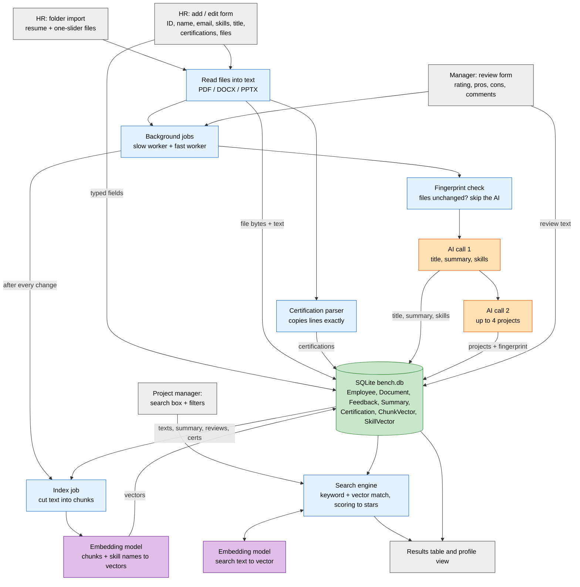
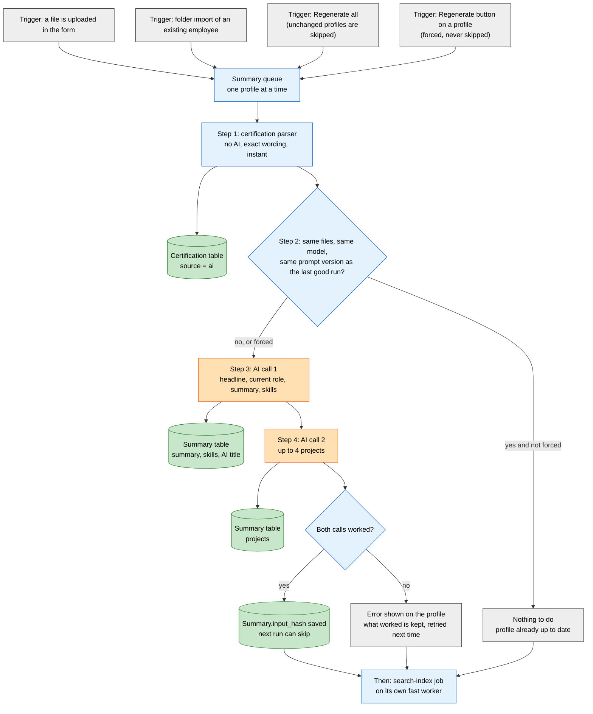
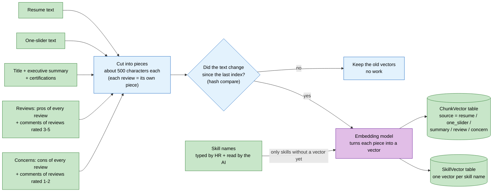
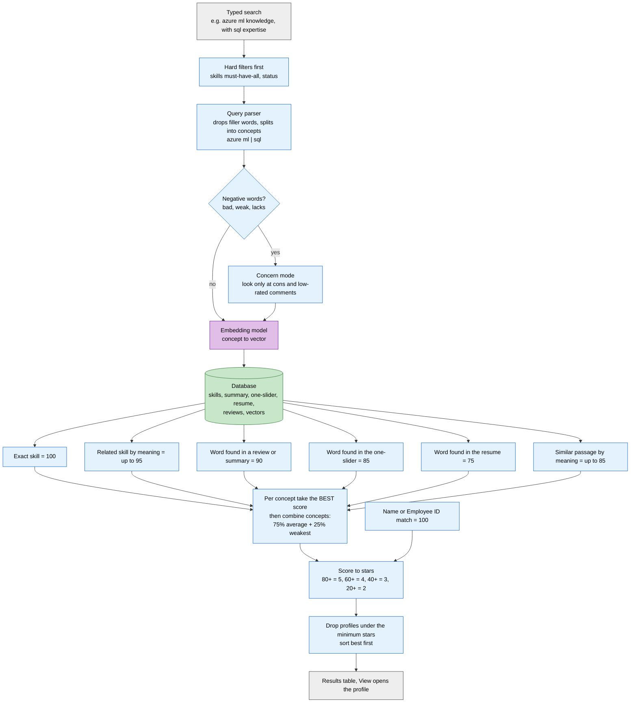
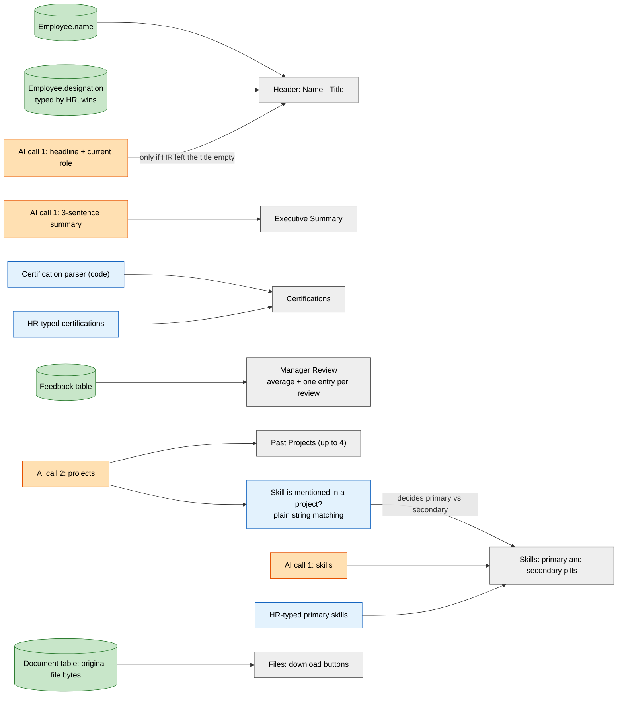

# Tredence Bench Hub

An internal tool for managing employees who are currently between projects ("the bench").

- **HR** imports or uploads profiles (resume + one-slider), and managers add project-based reviews.
- A **local AI** builds each profile: executive summary, title, skills and past projects.
- **Project managers** search the bench with hybrid (keyword + vector) search and open full profiles.

Everything runs on your own machine. No cloud, no external APIs, no Docker.

---

## Features

**Admin / HR portal**
- Import profiles from a folder: files are grouped by Employee ID, read, drafted by the AI, reviewed in a dialog, then uploaded.
- Add or edit one employee: ID, name, email, primary skills, designation, availability status, certifications, resume and one-slider.
- Add manager reviews (manager, project, rating 1-5, pros, cons, comments). The same manager + project replaces the earlier review.
- Maintenance: regenerate AI profiles for everyone whose files changed.

**Manager dashboard**
- Search by skill, project, name or Employee ID, in plain language ("azure ml knowledge, with sql expertise", "who is bad at azure ml").
- Filters: skills (must have all), status, minimum match stars.
- Results ranked best first, with a star rating.
- Profile view, with Send IM / Send Mail buttons for company email addresses.

**Profile view**
1. Name - Designation
2. Executive Summary
3. Skills: *Primary* (used in a project) and *Secondary*, as pills
4. Certifications
5. Past Projects (up to 4, from the one-slider first, otherwise the resume)
6. Manager Review (average rating + one entry per review)
7. Files (download resume and one-slider)

---

## Tech stack

Streamlit · SQLModel + SQLite (`bench.db`) · sqlite-vec · pdfplumber, python-docx, python-pptx · Ollama (local LLM and embeddings) · python-dotenv · pandas

Tested on Windows, VS Code, Python venv, CPU only (32 GB RAM).

---

## Project structure

```
bench-platform/
├── app.py                     Entry point: sidebar, Admin/HR tab, Dashboard tab
├── src/
│   ├── db/database.py         Models, engine, all database functions
│   ├── ai/
│   │   ├── ai_engine.py       Text extraction, prompts, summary + projects calls, certification parser
│   │   ├── embeddings.py      Embedding calls (documents and queries)
│   │   └── models.py          Model choices and score anchors
│   ├── search/
│   │   ├── skills.py          Skill normalisation and de-duplication
│   │   ├── indexer.py         Chunks and vectors for search
│   │   └── search.py          Query parsing, scoring, stars
│   ├── services/
│   │   ├── importer.py        Folder scan, drafts, upload
│   │   └── jobs.py            Background workers
│   └── ui/
│       ├── ui_theme.py        Styling
│       └── import_ui.py       Import section and review dialog
├── tests/
│   ├── test_database.py
│   └── test_ai_engine.py
├── assets/                    logo.png, banner.png
├── .streamlit/config.toml
├── requirements.txt, .env, .env.example, .gitignore, README.md
```

Rule: `ui` → `services` → `search` / `ai` / `db`. Only `app.py` and `src/ui/*` import Streamlit.

---

## Setup (Windows, PowerShell)

```powershell
# 1. Environment
python -m venv venv
.\venv\Scripts\Activate.ps1
pip install -r requirements.txt

# 2. Local models (Ollama must be installed and running)
ollama pull qwen2.5:7b
ollama pull qwen3-embedding:0.6b

# 3. Configuration
copy .env.example .env      # then edit .env

# 4. Run (always from the project root)
streamlit run app.py
```

The database file `bench.db` is created automatically on first start. New tables and columns are added automatically on later starts; existing data is never dropped. To start fresh, delete `bench.db` yourself.

---

## Configuration (`.env`)

| Key | Default | Meaning |
|---|---|---|
| `BENCH_DATABASE_URL` | `sqlite:///bench.db` | Database (never `DATABASE_URL`) |
| `OLLAMA_MODEL` | `qwen2.5:7b` | AI summary model (also selectable in the sidebar) |
| `OLLAMA_HOST` | `http://localhost:11434` | Ollama address |
| `OLLAMA_NUM_CTX` | `6144` | Context window in tokens |
| `OLLAMA_MAX_OUTPUT` | `600` | Upper limit for generated tokens per call |
| `OLLAMA_TIMEOUT` | `180` | Seconds to wait for one model call |
| `OLLAMA_KEEP_ALIVE` | `30m` | How long the model stays loaded |
| `OLLAMA_NUM_THREAD` | `0` | CPU threads for the summary model (0 = automatic; set to your physical core count) |
| `MAX_RESUME_CHARS` / `MAX_SLIDER_CHARS` | `9000` / `6000` | Safety caps only; normal files are read completely |
| `EMBED_MODEL` | `qwen3-embedding:0.6b` | Search (embedding) model |
| `EMBED_TIMEOUT`, `EMBED_MAX_CHARS`, `EMBED_BATCH` | `60`, `6000`, `16` | Embedding limits |
| `IMPORT_FOLDER` | empty | Default folder for the folder import |
| `CONTACT_ALLOWED_DOMAIN` | `tredence.com` | Send IM / Send Mail work only for this domain |

Changes to `.env` need a full restart of Streamlit.

---

## How it works

### Importing files
The Employee ID is the longest number in the file name:
```
1226_girish reddy resume.pdf
girish one slider 1226.pptx
```
Files without an ID are listed too, but need an ID typed in before upload. The extracted text is stored in the database, so the AI never re-reads the files.

### Building a profile
Each run has three parts:

1. **Certifications are read by code**, not by the AI. The parser finds the "Certifications" section and copies each line exactly (name, issuer, year). It runs at upload time, instantly. Certifications typed by HR are kept and always win.
2. **AI call 1 (summary):** title (headline + current role), a 3-sentence executive summary and skills.
3. **AI call 2 (projects):** up to 4 projects (name, one sentence, up to 4 tools, source).

Both calls send the same documents first and the task last, so Ollama reuses the already-read text and the second call skips most of the reading. Manager reviews are **not** part of the AI summary.

**Caching:** a fingerprint of the one-slider text + resume text + model + prompt version is stored. Automatic runs skip the AI when nothing changed. The per-profile *Regenerate summary* button always forces a fresh run. When you change the prompts, bump `PROMPT_VERSION` in `ai_engine.py`.

**Titles:** the title HR types always wins; the AI's title is stored separately and refreshed on every regenerate.

### Search
Each query is split into concepts ("azure ml", "sql"). For each employee and concept the best of these scores is used:

| Evidence | Score |
|---|---|
| Exact skill | 100 |
| Related skill (vector similarity) | up to 95 |
| Word in a manager review or the summary | 90 |
| Word in the one-slider | 85 |
| Word in the resume | 75 |
| Similar passage (vector match) | up to 85 |

Concepts combine as 75% average + 25% weakest, so covering everything beats covering one thing strongly. A name or Employee ID match scores 100. Scores map to stars: 80+ = 5, 60+ = 4, 40+ = 3, 20+ = 2.

Negative words ("bad at", "weak", "lacks") switch to **concern mode**, which searches only cons and low-rated review comments.

If the embedding model is unavailable, search falls back to keyword matching and shows a note.

What is indexed (per embedding model, re-embedded only when the text changes): resume chunks, one-slider chunks, a "summary" source (title + summary + certifications), review chunks (pros, and comments of reviews rated 3+), concern chunks (cons, and comments of reviews rated 1-2), and one vector per skill name.

### Background jobs
- **Summary worker:** one profile at a time (the slow AI calls).
- **Search-index worker:** separate, finishes in seconds, so a profile becomes searchable quickly.
- The sidebar shows "Profiles updating: N" and refreshes when a job finishes.
- A failed job never loses saved data; the profile shows the error, and the other call's result is still kept.
- Job queues live in memory: restarting Streamlit clears any waiting jobs.

---

## Data model

`Employee` · `Document` (file bytes + extracted text, one per type) · `Feedback` · `Summary` (one per employee: summary, skills, projects, AI title, input fingerprint) · `Certification` (source `ai` = found by the parser, `manual` = HR) · `SkillVector` · `ChunkVector`

Legacy and unused: `EmployeeEmbedding` and its functions.

---

## Tests

```powershell
python -m tests.test_database     # uses test_bench.db, never the real database
python -m tests.test_ai_engine    # certification parser, text cleaning, fingerprint; no Ollama needed
```

---

## Performance tips (CPU only)

- The cost is the **number of generated tokens**. A 7B model writes about 3-5 tokens/s on a laptop CPU; a full profile takes about 3-4 minutes in the background.
- Set `OLLAMA_NUM_THREAD` to your physical core count (PowerShell: `(Get-CimInstance Win32_Processor | Measure-Object -Property NumberOfCores -Sum).Sum`).
- Plug the laptop in and use the *Best performance* power plan.
- `qwen2.5:3b` is about twice as fast but invents more details (the title and projects checks reduce this).
- Every model call prints a timing line in the Streamlit terminal, for example `[ai] summary: prompt 1081 tokens in 55s, output 175 tokens in 55s`. On the second call, a much shorter prompt time means the documents were reused.
- Do not raise timeouts to work around slowness; reduce the output instead.

---

## Troubleshooting

| Symptom | What to do |
|---|---|
| "Cannot reach Ollama" | Start Ollama (`ollama serve`) and check `OLLAMA_HOST`. |
| "Model not installed" | Run the `ollama pull ...` command shown. |
| "The model took too long" | Check the timing lines; try `OLLAMA_NUM_THREAD`, a smaller model, or shorter documents. |
| New fields empty on an old profile | Click *Regenerate summary*, or *Maintenance → Regenerate all* (bump `PROMPT_VERSION` after prompt changes). |
| Certifications missing | Check the file has a "Certifications" heading; otherwise HR can type them in the Admin form. |
| Search does not find a new review yet | Wait a few seconds for the index worker; keyword matches work at once. |
| Changed `.env` or code has no effect | Fully stop and restart Streamlit. |

---

## Design rules

- Local LLM only (Ollama). No cloud, no external APIs.
- Lower layers never import Streamlit; `jobs.py`, `indexer.py` and `search.py` make no `st.*` calls.
- Every database function opens its own session and raises friendly `ValueError`s.
- AI failures (`SummaryError`, `EmbeddingError`) never lose saved data; the semantic part of search degrades to keyword matching.
- Emails are stored in lowercase; Employee ID is a unique string.
- Vectors are stored per embedding model and hash-checked, so switching a model re-indexes without deleting anything, and unchanged text is never re-embedded.
- Forms reset by bumping `nonce`; messages carry across `st.rerun()` with `flash()`.
- `st.set_page_config` is the first Streamlit call in `app.py`; `ui_theme.render_footer()` is the last line.
- New tables are created by `create_all`; small new columns go through the `init_db` migration. Existing data is never dropped automatically.

---

## Known limitations

- No login or roles yet: everyone sees the Admin tab.
- Model selection (sidebar) is per server process and resets to the `.env` defaults on restart.
- Scanned or image-only files have no extractable text (no OCR yet).
- Old `.doc` and `.ppt` files are not supported; save them as `.docx` / `.pptx`.
- The search score anchors in `models.py` are starting values and should be tuned on real data (40-50 profiles).
- The Strengths section is switched off; the view code is kept commented out in `app.py`.
- Projects are AI-only (not editable by HR).

---

## Roadmap

1. A small evaluation set (`tests/search_eval.py`: queries plus the employees who should match) to tune the star anchors and weights.
2. Tests for the vector tables, `indexer`, and `search.parse_query` / `run_search`.
3. Skill filter "any" option; delete employee or documents from the UI.
4. Optional LLM query expansion; per-user model choice; persisted model choice.
5. Remove the legacy `EmployeeEmbedding` code.
6. Later: login and roles, Postgres (pgvector) + Alembic, file storage outside the database, OCR for scanned files, logging and backups, lakehouse export.


### 1.Whole System : 


### 2.Building a profile


### 3.Searching 


### 4.What happens when someone searches


### 5.Where each part of the profile view comes from:
